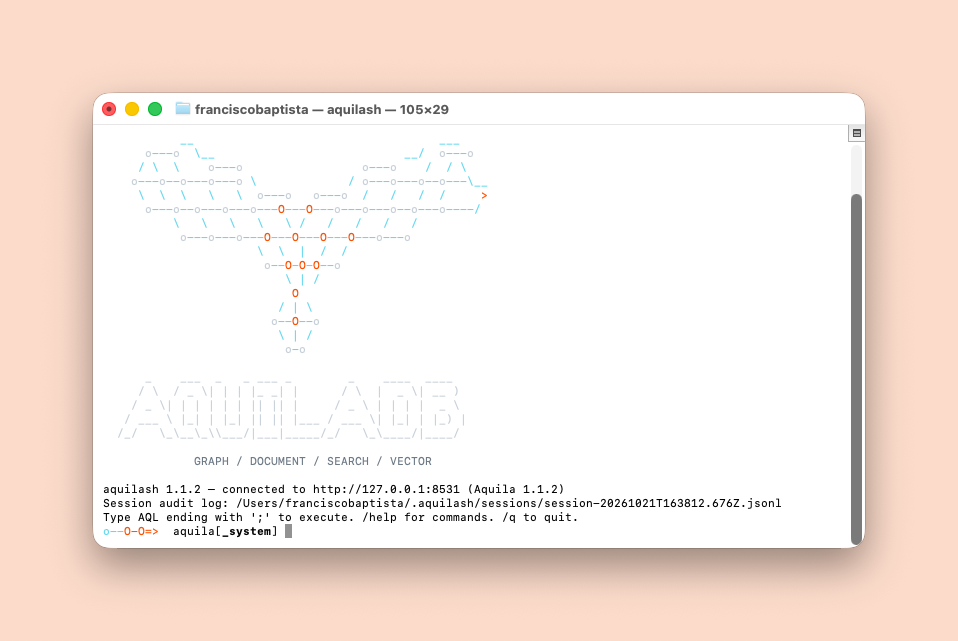

# AquilaDB

**A multi-model graph database for research.** AquilaDB keeps documents, a property graph, full-text search and vector search in one Rust engine, behind one query language. The privacy rules live inside the query compiler, not in the application around it.

AquilaDB grew out of one need: psychological and coaching research that must answer questions about a population, over time, without exposing any one person. The same engine also serves a second purpose. It gives a language model graph context with provenance, so the model can read evidence but cannot invent it.

This repository is the public face of the project: the description and the public issues. The source code is private.

<p align="center">
  
</p>

<p align="center"><em><code>aquilash</code>, the interactive AQL shell, connected to an AquilaDB server.</em></p>

## Why it matters to an organisation

Many organisations hold data about people as a network: who reports to whom, who works with whom, who was referred where, who took which programme. A graph is the natural model for this data. It is also the easiest way to expose a person by accident.

The risk is not only who can read the data. The risk is how small an answer gets. A report on "the two people in team X who took leave after the reorganisation" names those two people, even when it shows only a count. A graph makes this easy, because each hop through a relation makes a group smaller.

Most graph databases control access per collection, per label or per property. They do not usually control the size of a group in a result. The application must remember to do it, in every query, for every analyst. AquilaDB moves that rule into the query compiler.

### Where a cohort floor in a graph is useful

A collection opts in with one schema declaration. A subject field, such as `subject_id` or `case_id`, tells the engine which records belong to one person. After that, the rule does not depend on the domain.

| Domain | The graph | A typical question | What the floor stops |
|---|---|---|---|
| **Coaching and leadership development** | Coachees, sessions, themes, programmes | Which themes change after a programme, per business unit? | A business unit with one coachee in it. |
| **People analytics and HR** | Employees, teams, reporting lines, collaboration, survey answers | How does engagement differ between teams that share a manager? | A survey report on a team too small to stay anonymous. Many works councils require a minimum group size for exactly this reason. |
| **Health and care pathways** | Patients, referrals, clinics, treatments, outcomes | Which referral paths lead to a readmission? | A path that only one patient took. Health statistics often suppress small cells for the same reason. |
| **Education and learning** | Learners, courses, cohorts, assessments | Which course sequences predict a drop-out? | A sequence that identifies one learner. |
| **Social services and case management** | Cases, households, agencies, interventions | Which combination of services shortens a case? | A combination that matches one household. |
| **Research panels and surveys** | Respondents, answers, segments, waves | How does a segment move between survey waves? | A segment that a join narrows to one respondent. |

The common shape: the question is about a population, the data is about persons, and the relations are the valuable part.

### What it gives in practice

- **One rule, applied everywhere.** The floor applies to every grouped result, also through subqueries and graph traversals. A rewritten query gives the same protection.
- **Persons, not rows.** The engine counts distinct persons. Five records from one person are a group of one.
- **A visible suppression.** The response carries a warning, so a reader can tell a hidden group from an empty one.
- **A floor that only goes up.** The default is 5. A key can raise it where a policy asks for more. Only a key scoped to one owner's own records can lower it for that owner.
- **Sensitive fields that stay closed.** Each field has an encryption tier. Narrative and identity fields are encrypted at rest, and the compiler refuses a query that uses them in a way the tier does not allow.
- **Evidence that holds.** A study is pre-registered: the plan is hashed and approved before it runs. A pattern counts only when it is stable across runs.
- **An audit trail.** Every data change goes to a change log, with point-in-time restore and a live changefeed.
- **Safe use of AI.** A language model reads only through the same rules. Every number comes from the engine, and every quote is checked against its source.

In coaching and development work, this also gives the impact half of a return on investment: the engine measures change over time, and the cost side stays in the finance systems. The readouts describe change. They do not prove cause, unless the study design supports a causal claim.

### When it is not the right tool

AquilaDB is a single-node engine with one writer. It is built for research and analytics on people, not for every graph workload.

- **Use a general-purpose graph database** if the data is not about persons, if you need a cluster, or if many processes must write at the same time.
- **Do not use the floor to find one person.** Fraud detection and case investigation must reach individual records. The floor is for population questions.
- **The floor is not a full anonymisation.** It stops small groups in grouped results. It does not replace a data protection assessment, and it does not make a raw export anonymous.

## Heritage

AquilaDB is a re-implementation of the core of [ArangoDB](https://arangodb.com) in Rust. It keeps what ArangoDB does well and changes what a research graph cannot accept.

**What it keeps from ArangoDB:**

- **AQL.** The query language has broad parity with ArangoDB AQL: `FOR`, `FILTER`, `COLLECT`, `SORT`, `LIMIT`, graph traversals, `SHORTEST_PATH`, `K_SHORTEST_PATHS`, and the builtin function library. Each builtin follows the ArangoDB semantics, edge cases included. The engine checks this against the ArangoDB source, not against memory.
- **The multi-model idea.** A record is a document, a graph vertex, a search hit and a vector neighbour at the same time. You do not copy data between a document store, a graph store and a search engine.
- **The HTTP shape.** The API follows the ArangoDB layout: `/_api/cursor`, `/_api/document`, `/_api/collection`, `/_api/gharial` for named graphs.
- **An open grammar.** The AQL [tree-sitter grammar](https://github.com/FranciscoSerranoBaptista/tree-sitter-aql) is public.

**What it changes:**

| ArangoDB | AquilaDB | Why |
|---|---|---|
| C++, RocksDB, VelocyPack | Rust, [fjall](https://github.com/fjall-rs/fjall) LSM store, MessagePack | Memory safety, no C++ FFI, one build toolchain. |
| Cluster first | Single node, one writer | One writer is the throughput ceiling that research ingestion actually reaches. |
| Vectors stored with the documents | Vectors in a separate [usearch](https://github.com/unum-cloud/usearch) HNSW file, built in bulk | An HNSW insert in a B-tree or LSM store multiplies the write volume by about 100. |
| Full-text index by view | [tantivy](https://github.com/quickwit-oss/tantivy) BM25, opt-in per field | A full-text rebuild over all text fields caused out-of-memory failures at scale. |
| Access control per collection | Encryption tiers per field, and a cohort floor in the query compiler | Research on people needs rules on the result, not only on the collection. |

AquilaDB contains no ArangoDB source code. ArangoDB is a behavioural reference only.

## What makes it different

Most graph databases are general-purpose tools. They leave privacy, time, confidence and research method to the application. AquilaDB puts them in the engine.

| Concern | A general-purpose graph database | AquilaDB |
|---|---|---|
| **Small groups** | The application must remember to hide small counts. | The query compiler adds a **cohort floor** to every grouped `COLLECT` over clinical data. A group of fewer than 5 distinct persons does not come back, for every caller, admin included. |
| **Sensitive fields** | Access is per collection, or the application encrypts. | Each field has an **encryption tier**: `None`, `Coded`, `Narrative` or `Identity`. Narrative text is encrypted at rest with AES-256-GCM. Identity fields never leave without write rights. The compiler enforces the tiers before the query runs. |
| **Consent** | Not modelled. | A collection declares a consent field. A person without consent is removed from each analysis before it starts. The gate fails closed. |
| **Time** | Timestamps are plain properties. | Each node has a `TemporalContext`: creation time, validity window and a **decay function** (half-life, linear, step, sequence). A traversal can rank by recency and prune expired edges. |
| **Confidence** | A number on an edge, with no origin. | Each confidence value declares its basis: a human ruling, a validated judge, or counted evidence. **A language model never writes a confidence number.** `JUSTIFY(id)` returns the evidence chain and its weakest link. |
| **Retrieval for an LLM** | Vector search in one system, graph in another, glue code between them. | `GRAPH_RAG(...)` in one AQL call: vector seeds above a calibrated floor, graph expansion, reciprocal rank fusion, and rows that carry their provenance path. |
| **Novelty** | Not modelled. | `SURPRISE(id)` ranks neighbours that are close in meaning but far in the graph. These are the candidate bridges between two bodies of work. |
| **Research method** | Any caller can query until a result looks good. | A study is **pre-registered**. The plan is hashed before any evidence exists, an admin approves that hash, and the study runs once. A researcher key reaches only the approved studies. |
| **Analytics** | A community appears on each run, stable or not. | Community detection runs with **consensus stability** and **lineage** across runs. A pattern that does not hold across runs is reported as unstable, not as a finding. |

## Example: the cohort floor

A collection `coachees` holds six coachees in tech and one in pharma. An admin runs a grouped query:

```aql
FOR c IN coachees
  COLLECT industry = c.industry
  RETURN industry
```

The query does not ask for a count, but the compiler adds one. The pharma group has one person, so it does not come back. The response says why:

```json
{
  "result": ["tech"],
  "extra": {
    "warnings": [
      {
        "code": 2202,
        "message": "minimum-cohort (k-anonymity) floor of 5 applied: groups smaller than 5 were suppressed (#202)"
      }
    ]
  }
}
```

The same rule applies to the admin, to a rewritten query with a subquery, and to a vertex that a graph traversal reaches.

## The use case: psychological research under compliance

AquilaDB holds two kinds of data and treats them differently.

- **The research corpus** is one connected graph: works, chapters, ideas, concepts, persons and traditions, linked by citations, bridges, close matches and contradictions. Graph methods apply here: centrality, communities, paths, gaps between clusters.
- **Clinical data** is analysed through tables, time windows and trajectories, always under the cohort floor and the consent gate.

The compliance rules do not depend on a careful caller:

- **The cohort floor counts persons, not rows.** Five records from one client are a cohort of one, and the engine suppresses it.
- **Two phrasings give one answer.** The floor follows rows through subqueries and through graph traversals. A rewritten query does not escape it.
- **A suppressed result is visible.** The response carries a warning, so an empty group and a hidden group are different.
- **The floor can only go up.** Only a key scoped to one coach, with row access to that coach's own records, can lower it for that coach alone.
- **Every data change goes to a change log.** The log supports point-in-time restore and a live changefeed.

## A graph that gives context to a language model

AquilaDB ships an [MCP](https://modelcontextprotocol.io) server. A model reads the graph through tools such as `graph_rag`, `query`, `describe`, `justify`, `surprise`, `lit_search`, `lit_coverage`, `lit_citations`, `verify_quote` and `ground_quote`.

The rules for a model are strict:

- **The model articulates. It does not assert.** A model can describe a result in words. Every number, status and confidence comes from the engine or from a validation gate.
- **A quote must exist.** `ground_quote` binds a quoted passage to its source. `verify_quote` checks it again against the live source.
- **The context carries its source.** `GRAPH_RAG` admits a seed only above a calibrated similarity floor. Each row it returns carries its seed, its depth and the path from the seed.
- **The model works inside the floor.** A model with a researcher key sees only the results of approved studies, never the rows.

## The stack

| Part | Role |
|---|---|
| **AquilaDB** | The engine: the records, their relations over time, and the privacy rules. |
| **[KestrelAnalytics](https://github.com/FranciscoSerranoBaptista/KestrelAnalytics)** | Graph and population analytics: communities with stability, centrality, statistics, pre-registered studies. |
| **[PeacockUI](https://github.com/FranciscoSerranoBaptista/PeacockUI)** | The research console: start from a question, read ranked answers, keep the question with its finding. |

## Status

`v1.1.1`, the latest Aquila release (2026-10-12). Single node. In daily use for the author's own coaching research since May 2026.

Not in scope for v1: a distributed cluster, multiple concurrent writers, and the ArangoDB features that a single-node research graph does not need.

## Issues

Use the issues here for questions, ideas and collaboration requests. The working backlog is private.

**Do not post personal, clinical or coaching data in an issue.** An issue is public. To report a vulnerability, see [SECURITY.md](SECURITY.md).

© 2026 Francisco Serrano Baptista. All rights reserved.
